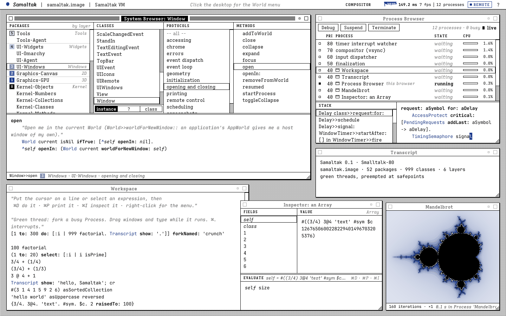
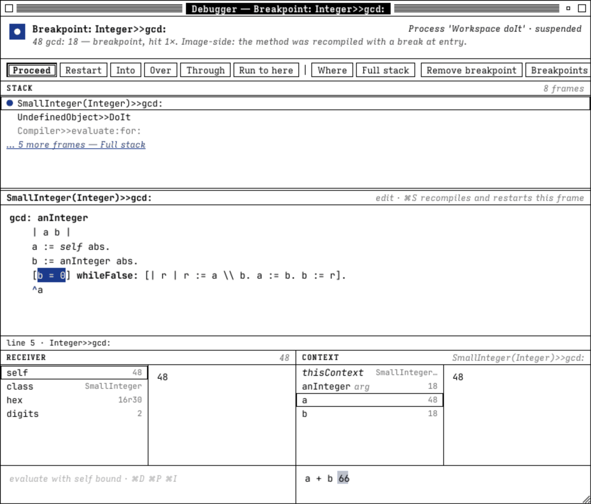
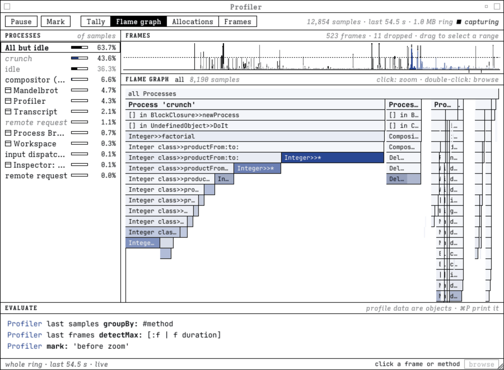
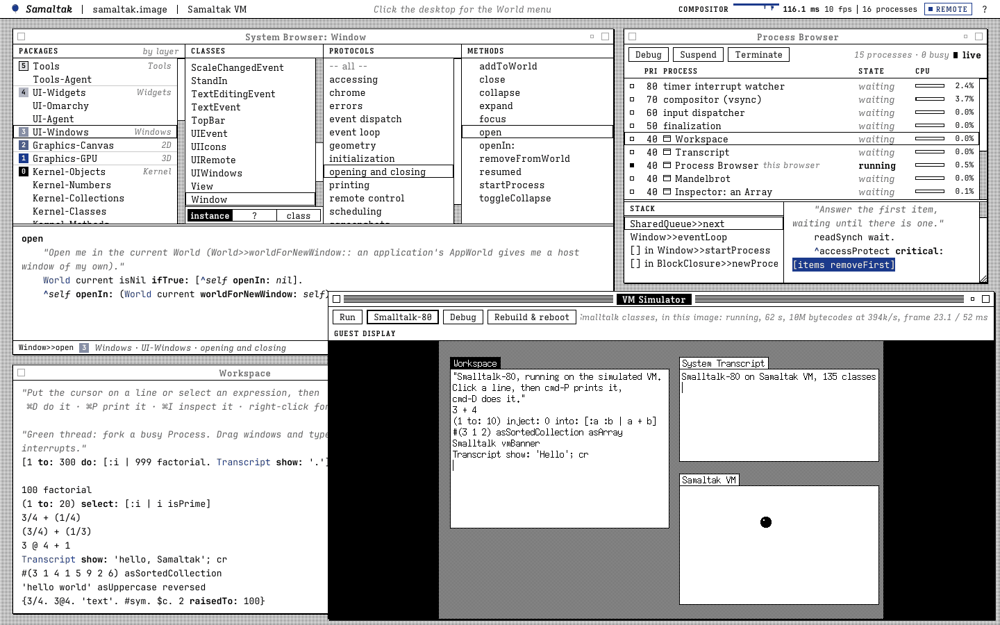

# Samaltak

A Smalltalk-80 system with green threads and a GPU-composited UI (SDL3 + SDL_GPU on Metal or Vulkan), written entirely in Smalltalk and built from the text sources in `src/`: the compiler, class library, fonts, renderer, window system, browser, debugger, profiler, agent and remote control, and the VM itself. The VM and its platform layer are written in Lowtalk, a subset of Smalltalk (docs/lowtalk.md): run as Smalltalk it is a simulator you can debug in the image; translated to C (`vm/gen/`) it is the VM.

Videos: [walkthrough](docs/media/walkthrough.mp4) · [mind blown](docs/media/mindblown.mp4) · [JIT](docs/media/jit.mp4)

| Debugger at a breakpoint | Profiler |
|---|---|
|  |  |

Smalltalk-80, booted on the VM run as Smalltalk (VM Simulator):

## Build and run

macOS on Apple Silicon (Homebrew `sdl3` and `openssl@3`), or Linux on arm64 or x86-64 (`sdl3`, `shaderc`, OpenSSL 3 and libwayland-client, e.g. `libssl-dev` and `libwayland-dev`; e.g. Asahi Linux, Vulkan). `.agents/setup` installs them on Debian bookworm (x86-64). The JIT emits arm64 or x86-64 (docs/jit.md).

    make            # VM (from vm/gen), seed image (ImageBuilder in boot/seed.image), stage 2 → build/samaltak.image, and build/runtime.image for apps
    make run        # start it (rebuilds the image first only if src/, boot/ or the VM changed since it was built or saved)
    make translate  # after changing the VM's Lowtalk sources (src/VM-Core, src/VM-Platform): regenerate vm/gen

One `vm/gen` serves all of them: what differs per OS is in modules for one OS (`targetOS`: the ticker, the code cache's memory, `PlatformHost`), which the build picks by `uname -s`; what differs per CPU (the assembler, and the code generators' functions that use it) by `uname -m` (`targetArch`, docs/lowtalk.md). On Linux shaders are GLSL (compiled to SPIR-V with shaderc) where macOS uses MSL, and the Alt key is ⌘ (Super is the window manager's).

## Applications

Samaltak programs can also run as windows of the desktop's window manager, straight from their source (docs/apps.md): the Omarchy desktop cards `apps/Weather`, `apps/Agents` and `apps/Wodify`.

    bin/samaltak run apps/Weather     # a floating Hyprland window in the Omarchy theme
    bin/samaltak test apps/Weather
    bin/samaltak install apps/Weather # an XDG .desktop entry for the launcher
    bin/samaltak agent                # the Agent (docs/agent.md) in a window of its own
    bin/samaltak desk                 # all card apps on the desktop, below the windows

## Test

    make test       # everything: VM suite, Smalltalk and app tests, GC-verified pass, FFI, each JIT, platform tests, samaltak-ctl scenarios, UEFI

Its stages (`make test-core`, `test-jit-*`, `test-tools`, `test-uefi`, …) also run on their own; CI runs them as parallel jobs.

## Remote control and the videos

`tools/samaltak-ctl` drives the running image (snapshot, click, type, key, eval, screenshot, record). `make video` replays `tools/walkthrough.mjs` against the real system, records the compositor's frames, and adds captions and ElevenLabs narration (`ELEVENLABS_API_KEY` in `.env`) → `docs/media/walkthrough.mp4` (needs ffmpeg). `make mindblown-video` and `make jit-video` make the other two.

For Zed syntax highlighting, install the [Smalltalk extension](tools/zed-smalltalk/README.md).

## Docs

- `docs/design.md` — decisions and why
- `docs/implementation.md` — object format, bytecodes, image format, primitives
- `docs/lowtalk.md` — the Smalltalk subset the VM is written in, its translation to C and its simulation
- `docs/jit.md` — the baseline and optimizing JITs
- `docs/benchmarks.md` — against GNU Smalltalk and Pharo
- `docs/ui.md` — the layers from GPU to tools
- `docs/platform.md` — the platform layer and its primitives
- [FFI](docs/ffi.md) — native call descriptors and launcher grants
- `docs/apps.md` — applications as Linux windows, run from source (AppWorld, Application, OmarchyTheme, apps/, the desk)
- `docs/agent.md` — the coding agent inside the image (⌘J)
- `st80/README.md` — the Smalltalk-80 guest on the VM Simulator
- `docs/uefi.md` — the headless VM as a UEFI application (bare metal, QEMU)
- `prototypes/` — the HTML prototypes the UI started from

## License

Samaltak's original code and documentation are licensed under the [MIT License](LICENSE).
Third-party material remains under its own terms; see [Third-party notices](THIRD_PARTY_NOTICES.md).
